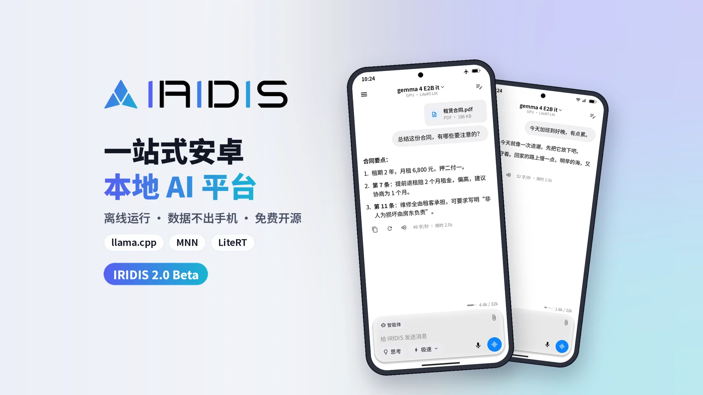
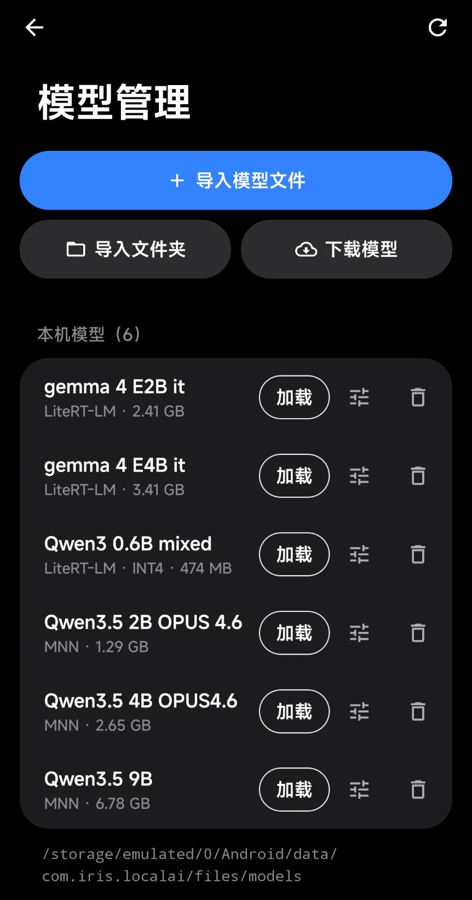

<p align="center"><a href="README.md">中文</a> | <b>English</b></p>

<p align="center">
  <picture>
    <source media="(prefers-color-scheme: dark)" srcset="docs/assets/wordmark-dark.svg">
    
  </picture>
</p>

<p align="center"><b>A large language model in your pocket.</b></p>

<p align="center">Chat, agent, voice and a local API, with all inference on your Android phone. Works in airplane mode.</p>

<p align="center">
  
  <a href="LICENSE"></a>
  <a href="CHANGELOG.md"></a>
</p>

<p align="center"></p>

<p align="center">
  <a href="https://github.com/WWRJ3321/IRIDIS/releases">Download</a> ·
  <a href="#quick-start">Quick start</a> ·
  <a href="docs/BUILD.md">Build from source</a> ·
  <a href="docs/API.md">Local API</a> ·
  <a href="docs/ARCHITECTURE.md">Architecture</a> ·
  <a href="CHANGELOG.md">Changelog</a>
</p>

<p align="center"><sub>The app UI and the linked docs are in Chinese; UI labels below are given in Chinese with an English gloss.</sub></p>

<!-- Screenshots: add the files to docs/assets/screenshots/, then delete the first and last line of this comment.
<table align="center">
  <tr>
    <td align="center" width="25%"><br><sub>Chat</sub></td>
    <td align="center" width="25%"><br><sub>Agent</sub></td>
    <td align="center" width="25%"><br><sub>Voice</sub></td>
    <td align="center" width="25%"><br><sub>Models</sub></td>
  </tr>
</table>
-->

## Features

<table>
  <tr>
    <td width="50%" valign="top">
      <b>Local chat</b><br>
      Qwen3, Gemma 3, DeepSeek-R1 distills and other open models; download in the app or import your own files.<br>
      Toggleable, collapsible thinking with real tok/s; Markdown rendering, edit and resend, chat search.<br>
      Multi-turn chats reuse the KV prefix and only compute new tokens.
    </td>
    <td width="50%" valign="top">
      <b>Agent</b><br>
      Reads, writes and edits workspace files, runs Linux commands, searches and reads the web.<br>
      Plans, skills, long-term memory and scheduled tasks; can set alarms and add calendar events.<br>
      Every file change can be reverted in one tap.
    </td>
  </tr>
  <tr>
    <td width="50%" valign="top">
      <b>Offline voice</b><br>
      Push to talk: SenseVoice recognizes Chinese, Cantonese, English, Japanese and Korean.<br>
      Hands-free conversation: speaks while generating; talk to interrupt.<br>
      Multiple voices (e.g. Kokoro multi-speaker zh/en), with voice cloning.
    </td>
    <td width="50%" valign="top">
      <b>Tuned for phones</b><br>
      Three engines (llama.cpp, LiteRT-LM, MNN) across CPU, GPU and Qualcomm NPU.<br>
      KV cache reuse, thermal throttling and idle unloading keep long sessions cool.<br>
      Built-in OpenAI- and Ollama-compatible local API.
    </td>
  </tr>
</table>

<details>
<summary><b>Agent tools</b></summary>
<br>

Turn on the 智能体 (Agent) switch next to the input box and the model can call these tools:

| Category | Capabilities |
|---|---|
| Files | Read, write, search and precisely edit files in the workspace; parse documents; changes can be reverted in one tap |
| Terminal | Built-in Alpine Linux (PRoot, no root), or the built-in sh or Termux; per-prefix command permissions |
| Web | Web search (Bing / DuckDuckGo / SearXNG) and page reading, with long pages split automatically |
| Planning & memory | Plans / to-dos, skills (`SKILL.md`), long-term memory (`USER.md` / `MEMORY.md`), full-text history search |
| Automation | Scheduled tasks, heartbeat self-wake (optionally only while charging) |
| Phone actions | Open apps and links, set alarms, add calendar events, read the clipboard |

</details>

## Quick start

1. Download the APK from [Releases](https://github.com/WWRJ3321/IRIDIS/releases) and install it.
2. Open 模型管理 (Models) and download a recommended model.
3. Go back to the chat and start talking; turn on 智能体 (Agent) when you need tools.

**Requirements**: arm64, Android 12 or later, a CPU with dotprod / i8mm (Snapdragon 8 Gen 1 or newer). 12 GB of RAM is recommended for 4B–8B models.

> [!NOTE]
> Upgrading from IRIS LocalAI: since 2.1.0 the package name is `com.iridis`, so it cannot install over the old app. Export a backup in the old app (设置 › 智能体 › 备份, Settings › Agent › Backup), install the new one, then import it in 设置 › 存储 › 备份与恢复 (Settings › Storage › Backup & restore).

## Inference engines

| Engine | Model format | Hardware | Variant |
|:---|:---|:---|:---|
| llama.cpp | GGUF (`.gguf`) | CPU (KleidiAI), GPU (OpenCL) | `lite` / `full` |
| LiteRT-LM | `.litertlm` | GPU, Qualcomm NPU | `full` |
| MNN-LLM | Taobao-MNN model folder | CPU FP16, GPU (OpenCL) | `full` |

- Start with Qwen3-4B Q4_K_M (GGUF); phones with 12 GB of RAM can try 8B.
- LiteRT models come from `litert-community`; files with a chip suffix (e.g. `*.sm8750`) are NPU-only builds.
- NPU acceleration needs a Snapdragon 8-series chip and the QNN runtime, downloaded in the app after accepting Qualcomm's license.
- Put models in `Android/data/com.iridis/files/models/`, or pick them via 模型管理 › 导入 (Models › Import).

## Local API

Enable it under 设置 › API 服务 (Settings › API server) and the phone becomes a model server:

- OpenAI-compatible: `/v1/chat/completions`, `/v1/models`; Ollama-compatible: `/api/chat`.
- Listens on `127.0.0.1:8686` only by default; LAN access must be turned on manually and requires an API key.

```bash
curl http://127.0.0.1:8686/v1/chat/completions \
  -H "Content-Type: application/json" \
  -d '{"messages":[{"role":"user","content":"Introduce yourself in one sentence."}]}'
```

See [docs/API.md](docs/API.md) for the full reference.

## Privacy

Chats, memory and workspace files stay on the phone, and cloud backup is disabled. The app only goes online when:

- you download a model, voice pack, the built-in Linux or the NPU runtime;
- the agent runs a web search or reads a web page;
- you turn on the local API server (local-only by default).

"All files access" is used only if you grant it under 设置 › 智能体 (Settings › Agent), so the agent can edit files other apps put in `Download/IRISLocalAI`. The microphone is used only while the voice screen is open.

## Build from source

Requires JDK 17 or 21, Android SDK 35, NDK r27c or later, and CMake 3.22 or later.

```bash
sh scripts/fetch-deps.sh                        # llama.cpp sources, sherpa-onnx, MNN prebuilt libraries
cp local.properties.example local.properties    # set sdk.dir (and ndk.path)
./gradlew testFullDebugUnitTest                 # unit tests
./gradlew assembleFullRelease                   # all three engines; llama.cpp only: assembleLiteRelease
```

| Variant | Engines | APK size |
|:---|:---|:---|
| `lite` (default) | llama.cpp | ~16 MB |
| `full` | llama.cpp + LiteRT-LM + MNN | ~29 MB |

See [docs/BUILD.md](docs/BUILD.md) for signing and details, and [docs/ARCHITECTURE.md](docs/ARCHITECTURE.md) for the code structure.

## Contributing

Issues and pull requests are welcome. Please make sure all unit tests pass, and describe the change and how you tested it in the PR.

## License

IRIDIS is licensed under the [Apache License 2.0](LICENSE); see also [NOTICE](NOTICE).

Third-party components (llama.cpp, MNN, LiteRT-LM, sherpa-onnx, PRoot and others) are under their own licenses; see [THIRD_PARTY_NOTICES.md](THIRD_PARTY_NOTICES.md). The full texts are also available in the app under 设置 › 关于 (Settings › About). The Qualcomm QNN runtime is proprietary and is not distributed with the source or the APK. Some optional voice models (Matcha zh-baker, ZipVoice distill, Piper xiao_ya and others) are for non-commercial use only.

## Disclaimer

This software is provided "as is", without warranty of any kind. AI-generated content can be wrong; do not rely on it for medical, legal, financial or other important decisions. The agent can run commands, modify workspace files, open apps and access the network. Only enable it with models and content you trust, and watch out for prompt injection hidden in web pages or files.
