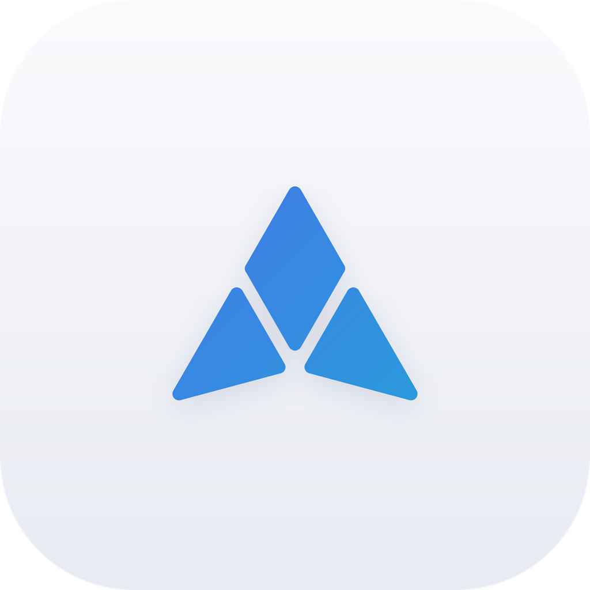

<p align="center"><b>中文</b> | <a href="README.en.md">English</a></p>

<p align="center">
  <picture>
    <source media="(prefers-color-scheme: dark)" srcset="docs/assets/icon-dark.png">
    
  </picture>
</p>

<p align="center">
  <picture>
    <source media="(prefers-color-scheme: dark)" srcset="docs/assets/wordmark-dark.svg">
    
  </picture>
</p>

<p align="center">
  <b>一站式安卓本地 AI 平台</b><br/>
  离线运行 · 数据不出手机 · 免费开源<br/>
  <sub>All-in-one on-device AI for Android. Offline, private, open source.</sub>
</p>

<p align="center">
  <a href="https://github.com/WWRJ3321/IRIDIS/releases/latest"><b>下载 APK</b></a> ·
  <a href="docs/BUILD.md">构建</a> ·
  <a href="docs/API.md">API</a> ·
  <a href="docs/ARCHITECTURE.md">架构</a> ·
  <a href="CHANGELOG.md">更新日志</a>
</p>

<p align="center">
  
  <a href="LICENSE"></a>
  <a href="CHANGELOG.md"></a>
</p>

<p align="center"></p>

---

## 亮点

| | |
|---|---|
| **三大推理引擎** | llama.cpp · MNN · LiteRT-LM，CPU / GPU / NPU 按机型选最快 |
| **完全离线** | 推理、语音、记录都在本机，飞行模式照常可用 |
| **智能体** | 读写文件、Linux 终端、联网搜索、定时任务，改动可撤销 |
| **记忆与知识库** | 长期记忆、本地文档检索，消息可编辑、可多版本重新生成 |
| **本地语音** | 离线识别与合成，免提对话，开口即可打断 |
| **局域网 API** | OpenAI / Ollama 兼容，手机就是模型服务器 |
| **为手机调校** | KV 缓存复用、温度限速、空闲卸载 |

## 快速开始

1. 从 [Releases](https://github.com/WWRJ3321/IRIDIS/releases/latest) 安装 APK
2. 在「模型管理」下载或导入模型
3. 开聊；需要工具时打开「智能体」

**要求**：Android 12+、arm64（骁龙 8 Gen 1 及以上）；4B 以上模型建议 12 GB 内存。

> [!NOTE]
> 从 IRIS LocalAI 升级：2.1.0 起包名改为 `com.iridis`，不能覆盖安装。先在旧版导出备份，装新版后在 设置 › 存储 › 备份与恢复 导入。

## 引擎

| 引擎 | 格式 | 硬件 |
|---|---|---|
| llama.cpp | `.gguf` | CPU · GPU (OpenCL) |
| MNN-LLM | MNN 模型文件夹 | CPU · GPU (OpenCL) |
| LiteRT-LM | `.litertlm` | GPU · 高通 NPU |

NPU 需骁龙 8 系芯片，并在 App 内同意高通许可后下载 QNN 运行库。

## 本地 API

设置 › API 服务 中开启。默认只监听本机；开放局域网须手动开启并使用 API Key。

```bash
curl http://127.0.0.1:8686/v1/chat/completions \
  -H "Content-Type: application/json" \
  -d '{"messages":[{"role":"user","content":"你好"}]}'
```

## 隐私

对话、记忆和文件只存于本机，禁止云备份。仅在你下载模型 / 语音包 / 运行库、智能体联网、或开启 API 时联网。

## 构建

```bash
sh scripts/fetch-deps.sh
cp local.properties.example local.properties   # 填 sdk.dir / ndk.path
./gradlew assembleFullRelease                  # 仅 llama.cpp：assembleLiteRelease
```

JDK 17 · Android SDK 35 · NDK r27c+ · CMake。详见 [docs/BUILD.md](docs/BUILD.md)。

## 许可证

[Apache-2.0](LICENSE)。第三方组件见 [THIRD_PARTY_NOTICES.md](THIRD_PARTY_NOTICES.md)；QNN 运行库为高通专有软件，不随源码分发；部分可选语音模型仅限非商业使用。

> AI 输出可能出错，请勿用于医疗、法律、金融等重要决策。智能体可执行命令与联网，请只对信任的内容开启。
